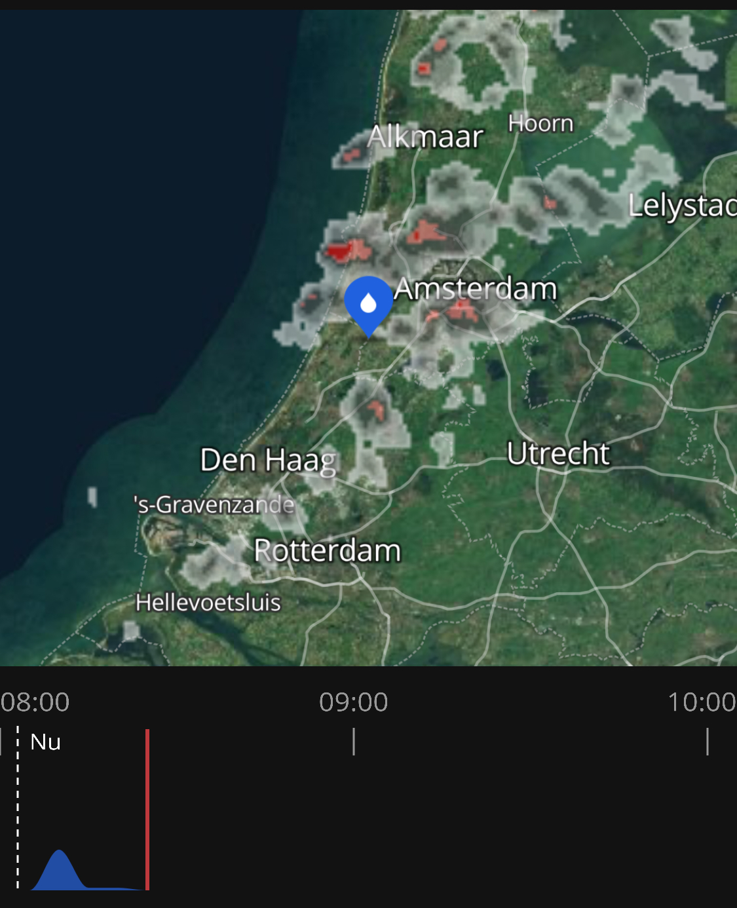
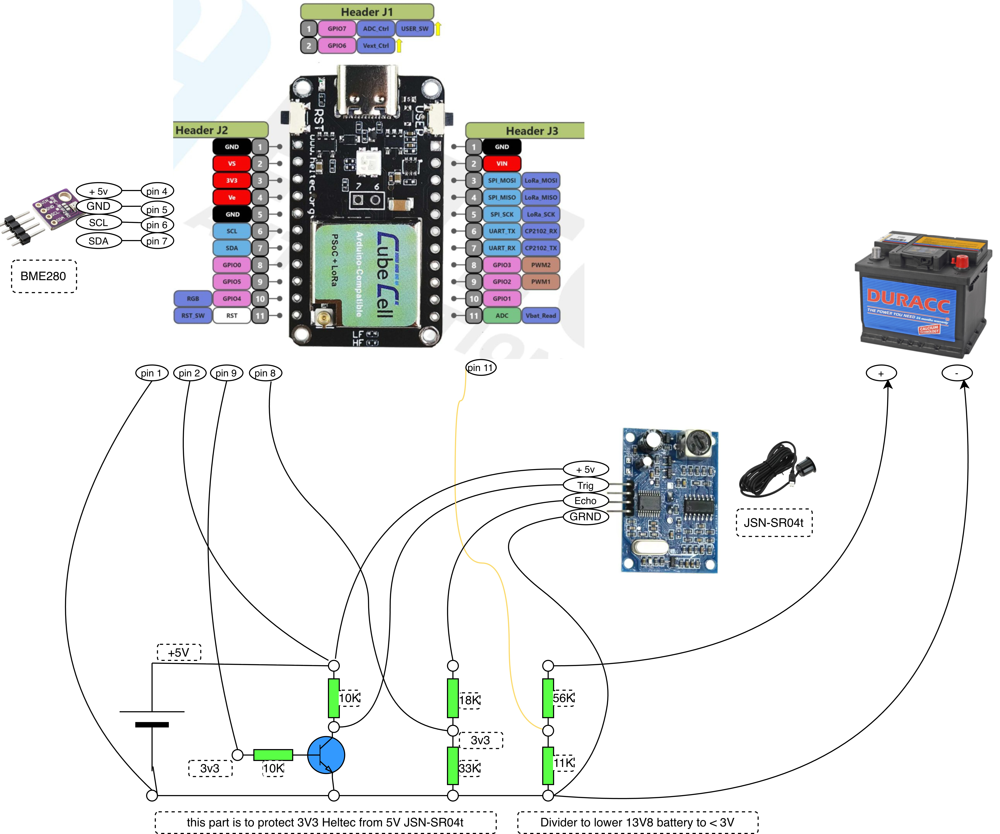

# heltec-lora-boatreadings

Remote bilge monitoring for my boat: water level, battery voltage and weather, sent over LoRaWAN (The Things Network) to Home Assistant.


## Why this project?

I found out the hard way that a bilge pump setup can falter: in my case it resulted in a sunken boat (a *sloep*, in Dutch).

My bilge pump runs on a 12 V battery, which is charged by a small solar panel. A solar charge controller charges the battery and protects it from being drained below a certain level, for example after a lot of rain and little sun. As long as there is enough sunshine and no connection breaks because of storm, rain or bad luck, the pump automatically removes rain water from the boat.

Because connections can break and the battery can run low, I wanted to measure **the battery voltage and the bilge water level remotely**.

## What does it show?

### No rain
The battery voltage drops by about a volt during the night and is charged back to its nominal level during the day. The bilge water level stays the same.

### Rain
The bilge water level slowly rises until the battery voltage shows a sudden dip: the bilge pump has started. After that the water level is back to nominal.

The graph below shows exactly that. Each dip in the battery voltage (top) lines up with a change in the measured distance to the water (bottom): the pump kicks in and the level drops again.


The rain radar of the same morning shows the showers passing over the boat:



## How is it built?

```
JSN-SR04T ─┐
BME280 ────┼─► Heltec AB01 V2 ──LoRaWAN──► The Things Network ──MQTT──► Node-RED ──► Home Assistant
12 V divider ┘   (CubeCell)
```

### Hardware

| Part | Purpose |
|------|---------|
| Heltec CubeCell HTCC-AB01 V2 | Microcontroller with LoRa radio |
| JSN-SR04T | Waterproof ultrasonic distance sensor, measures the distance to the water in the bilge |
| BME280 | Bonus: air temperature, humidity and pressure |
| Voltage divider (56 kΩ / 11 kΩ) | Brings the ~13.8 V battery voltage below 3 V for the ADC pin |
| 10 kΩ / transistor + 18 kΩ / 33 kΩ divider | Protects the 3.3 V Heltec from the 5 V JSN-SR04T (supply switching and echo level) |
| 12 V battery, small solar panel, solar charge controller | Power for the bilge pump and for this monitor |

### Wiring



| Signal | Heltec pin |
|--------|-----------|
| JSN-SR04T trigger | GPIO5 (J2-9) |
| JSN-SR04T echo | GPIO0 (J2-8), via the 18 kΩ / 33 kΩ divider |
| Battery voltage | ADC (J3-11), via the 56 kΩ / 11 kΩ divider |
| BME280 | I²C: SCL (J2-6), SDA (J2-7), powered from Vext (J2-4) |

> The firmware uses a measured division factor (`EXTERNAL_DIVISION_FACTOR`) and a measured ADC reference voltage (`ADC_VREF`). Calibrate both against a multimeter for your own board.

### Photos

The sensor looks down a tube that sticks into the bilge:


The electronics sit in a watertight box:


The solar charge controller feeds the battery and shields it against deep discharge:


## Firmware

The sketch is in [`src/HELTEC_HTCC_AB_V2_BME280_JSN_SR04T_september2025.ino`](src/HELTEC_HTCC_AB_V2_BME280_JSN_SR04T_september2025.ino).

1. Install the Arduino IDE with the Heltec **CubeCell** board package and the `Seeed_BME280` library.
2. Copy `include/ttnparams.example.h` to `include/ttnparams.h` and fill in your own DevEUI, AppEUI and AppKey from the TTN console. This file is git-ignored, so your keys never end up in the repository.
3. Select the CubeCell HTCC-AB01 V2 board, choose the LoRaWAN region (EU868 in the Netherlands), OTAA and class A in the Tools menu, then upload.

The node sends one uplink every ~3 minutes (`appTxDutyCycle`), with the sensors only powered while measuring (Vext).

### Payload (port 2, 16 bytes, big-endian)

| Bytes | Field | Unit / scaling |
|-------|-------|----------------|
| 0–1 | Temperature | signed, °C × 100 |
| 2–3 | Humidity | % |
| 4–7 | Pressure | Pa |
| 8–9 | Heltec supply voltage | mV |
| 10–11 | Heltec battery level | % |
| 12–13 | Distance to water | cm (`0` = no echo) |
| 14–15 | External (boat) battery voltage | mV |

A ready-made TTN uplink decoder is in [`ttn/payload-formatter.js`](ttn/payload-formatter.js): paste it in the TTN console under *Payload formatters → Uplink → Custom JavaScript*. Its output keys (`temperature`, `humidity`, `pressure`, `battery`, `battery_level`, `distance`, `external_voltage` in mV) are exactly what the Node-RED flow below expects.

## The Things Network → Node-RED → Home Assistant

```
TTN (MQTT) → Node-RED → local Mosquitto → MQTT auto-discovery in Home Assistant
```

The complete flow is in [`nodered/flow.json`](nodered/flow.json). Import it in Node-RED via *Menu → Import*.

What the flow does with every uplink:

| Node | Purpose |
|------|---------|
| **TTN MQTT** | Subscribes to `v3/+/devices/+/up` on `eu1.cloud.thethings.network` (TLS, port 8883) |
| **Extract payload** | Takes the decoded payload from TTN and adds `rssi`, `snr` and `gateway_id` of the best gateway |
| **MQTT Discovery** | Publishes a Home Assistant discovery config per value, so entities appear automatically with the right device class and unit |
| **Publish states** | Publishes each value to `home/<device_id>/<key>` (retained) |
| **Uplink interval** | Seconds since the previous uplink, to spot a silent sensor |
| **Last update** | Timestamp of the last uplink |
| **Gateway tracker** | Counts uplinks, RSSI, SNR and last-seen time per receiving gateway and exposes them as one `gateways` sensor |

### Setting it up

1. In the TTN console create an **API key** for your application with the right to read uplinks, and add the *payload formatter* from this repository.
2. Import `nodered/flow.json`.
3. Open the **TTN** MQTT broker node: set your TTN application as username (`<application-id>@ttn`) and the API key as password. Credentials are not part of the export, so nothing secret is stored in this repository.
4. Open the **Home MQTT** broker node and point it to the Mosquitto broker that Home Assistant uses (the flow assumes the host name `mosquitto`).
5. Deploy. The entities show up in Home Assistant under the device *Heltec heltec*.

### Home Assistant dashboard and alerts

- [`homeassistant/dashboard.yaml`](homeassistant/dashboard.yaml): the *Boot* dashboard with gateways, climate, battery voltage and bilge water level.
- [`homeassistant/bilge-alerts.yaml`](homeassistant/bilge-alerts.yaml): draft automations (water level stays high, battery drops while the level stays high, battery low, sensor silent). Check thresholds and notify service before use.
- [`homeassistant/bilge-waterpeil.yaml`](homeassistant/bilge-waterpeil.yaml): the template sensor `sensor.bilge_waterpeil` = 55 − `distance` (cm, never below 0). The water level in the bilge is normally around 10 cm.

## License

Released into the public domain under [The Unlicense](LICENSE): use it for anything you like. The wiring diagram contains pictures of third-party parts (Heltec pinout, JSN-SR04T, battery) that are not covered by this dedication.

See [`IMPROVEMENTS.md`](IMPROVEMENTS.md) for ideas on where to take this project next.
